<p align="center">
  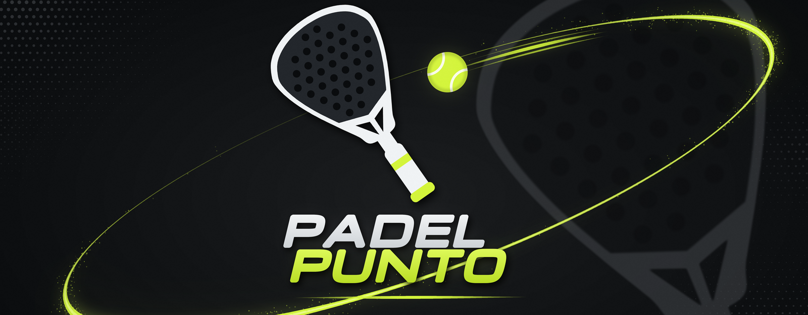
</p>

<h1 align="center">Padel Punto · Desktop-Theme</h1>

<p align="center"><a href="README.md">English</a> · <b>Deutsch</b></p>

<p align="center">
  <b>Ink-Schwarz trifft Lime.</b> Ein Komplett-Theme für Linux Mint (Cinnamon), dunkel oder hell:<br>
  Fenster, Leisten, Dock, Icons, Terminal, Qt-Programme und Hintergründe in den Farben von Padel Punto.
</p>

<p align="center">
  
  
  
  
  <a href="https://github.com/PadelPunto"></a>
</p>

<p align="center">
  <a href="#-dunkel--hell">Dunkel & hell</a> ·
  <a href="#-installieren">Installieren</a> ·
  <a href="#-wo-finde-ich-was">Wo finde ich was?</a> ·
  <a href="#-bilder">Bilder</a> ·
  <a href="#-hilfe">Hilfe</a> ·
  <a href="#-entfernen">Entfernen</a>
</p>

<p align="center">
  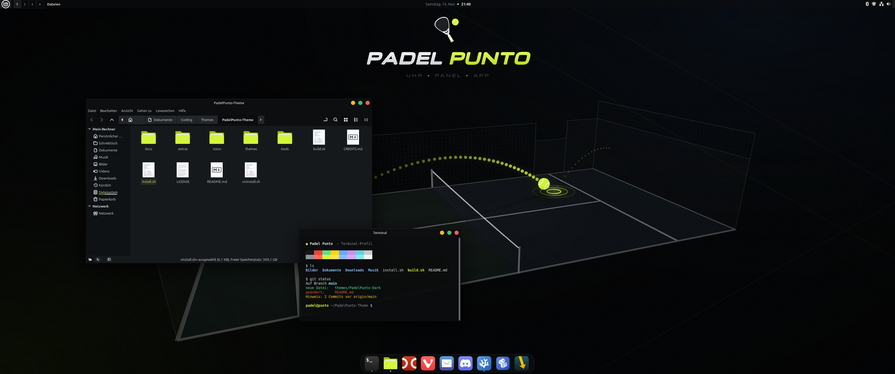
</p>

## ✨ Das ist drin

<table>
  <tr>
    <td width="50%" valign="top">
      <h3>🖥️ Theme</h3>
      Fenster, Menüs, Startmenü, Benachrichtigungen und Alt-Tab in tiefem Ink (oder hellem Weiß) mit Lime-Akzent.
      Ausgewählte Einträge bekommen einen schmalen Lime-Balken, die Fensterknöpfe sind bunte Mac-Punkte.
      Gilt für alte und neue Programme (GTK 2, GTK 3, GTK 4 und libadwaita).
    </td>
    <td width="50%" valign="top">
      <h3>📁 Icons</h3>
      Auf Basis von Papirus (Dark / Light): moderne, flache Icons für fast jede App und jeden Dateityp.
      Die Ordner leuchten in Lime, Musik, Bilder, Downloads & Co. behalten ihre Symbole.
    </td>
  </tr>
  <tr>
    <td width="50%" valign="top">
      <h3>⚓ Dock & obere Leiste</h3>
      Unten ein Dock mit schwebender Pille und Punkten unter laufenden Programmen.
      Oben eine schmale Leiste mit Menü, Arbeitsflächen (die aktive als Lime-Pille), aktivem
      Programm und der Uhr mit Lime-Punkt in der Mitte. Deine angehefteten Programme bleiben erhalten.
      Arbeitsfläche wechseln mit <kbd>Strg</kbd> + <kbd>Alt</kbd> + <kbd>←</kbd> / <kbd>→</kbd>,
      Übersicht mit <kbd>Strg</kbd> + <kbd>Alt</kbd> + <kbd>↑</kbd>.
    </td>
    <td width="50%" valign="top">
      <h3>⌨️ Terminal, Double Commander & Hintergründe</h3>
      Ein Terminal-Profil mit Lime-Cursor und abgestimmter Farbpalette,
      Ink & Lime für Double Commander und neun Padel-Punto-Hintergründe, dunkel und hell,
      bis 3840×2160 – und einen, der über zwei Bildschirme reicht.
    </td>
  </tr>
  <tr>
    <td colspan="2" valign="top">
      <h3>🧩 Qt-Programme</h3>
      Programme, die mit Qt statt GTK gebaut sind – VLC, KeePassXC, qBittorrent, OBS und andere – bekommen
      über ein Kvantum-Theme denselben Look: Lime-Auswahl, Ink- oder weiße Flächen, Ink-Schrift auf Lime. Dunkel und hell.
    </td>
  </tr>
</table>

<p align="center">
  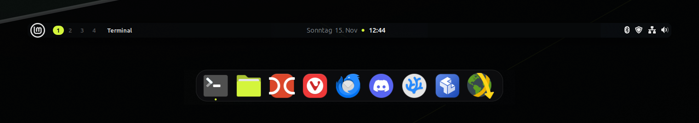
</p>

## 🌗 Dunkel & hell

<p align="center">
  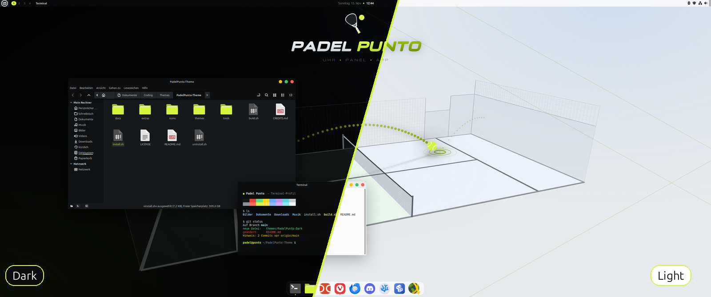
</p>

Beide Varianten werden immer installiert. Du wählst, welche eingeschaltet ist, und wechselst
jederzeit mit einem Befehl – Leisten, Dock, Terminal, Double Commander, Qt-Programme und Hintergrund ziehen mit:

```bash
./install.sh --hell      # auf hell umschalten
./install.sh --dunkel    # zurück zu dunkel
```

Die Wahl wird gemerkt, spätere Updates behalten sie. In der hellen Variante bleibt Lime die Farbe
für Flächen (Auswahl, Schalter, heute im Kalender); Schrift und Linien bekommen ein tieferes Lime
`#557000`, das auf Weiß gut lesbar bleibt.

<p align="center">
  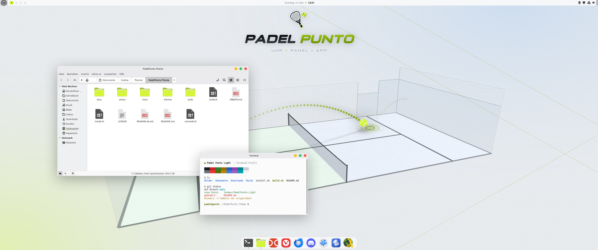
</p>

## 🚀 Installieren

> **Voraussetzung:** Linux Mint mit Cinnamon (getestet mit Mint 22.3 und Cinnamon 6.6).
> Das Theme landet nur in deinem Benutzerordner, dafür ist kein Passwort nötig.
> Nur wenn etwas fehlt – die Papirus-Symbole oder die Kvantum-Engine für Qt-Programme –,
> bietet das Skript an, es für dich zu installieren (dann fragt es einmal nach deinem Passwort).

**1. Herunterladen.** Mit git:

```bash
git clone https://github.com/fat-toni/PadelPunto-Theme
cd PadelPunto-Theme
```

<sub>Ohne git: oben auf dieser Seite **Code → Download ZIP**, die Datei entpacken,
den Ordner öffnen, Rechtsklick in eine freie Stelle → **Im Terminal öffnen**.</sub>

**2. Installieren und einschalten** – dunkel oder hell:

```bash
./install.sh --alles          # dunkel
./install.sh --alles --hell   # hell
```

**3. Fertig.** Das Theme ist sofort aktiv. Damit wirklich alles umschaltet, auch die Fensterrahmen
und schon geöffnete Programme, einmal **ab- und wieder anmelden**.

Deine bisherigen Einstellungen merkt sich das Skript. `./uninstall.sh` holt sie jederzeit zurück.

<details>
<summary><b>Nur einzelne Teile installieren</b></summary>
<br>

Statt `--alles` lassen sich die Teile einzeln wählen und kombinieren:

| Option | Was passiert |
|---|---|
| *(keine)* | beim ersten Mal: Themes und Icons nur kopieren, nichts umschalten. Auswählen dann selbst unter **Systemeinstellungen → Themen**. Später: Update mit deiner bisherigen Auswahl |
| `--aktivieren` | Theme und Icons einschalten, dunkler (oder heller) Modus für alle Apps, Padel-Punto-Farben auch für neuere GNOME-Apps |
| `--dock` | obere Leiste (32 px) und Dock (76 px) wie auf den Bildern einrichten |
| `--terminal` | Terminal-Profile „Padel Punto“ und „Padel Punto Light“ anlegen (das passende wird mit `--aktivieren` Standard) |
| `--doublecmd` | Double Commander in Ink & Lime (ist er offen, bittet das Skript dich, ihn zu schließen) |
| `--qt` | derselbe Look für Qt-Programme wie VLC oder KeePassXC (Kvantum-Theme; installiert bei Bedarf die Kvantum-Engine, aktiv nach Ab- und Anmelden) |
| `--flatpak` | Flatpak-Apps dürfen Theme, Icons und Farben lesen (nur Lesezugriff) |
| `--hintergrund` | Hintergründe kopieren (mit `--aktivieren` passend zur Bildschirmgröße setzen; bei zwei Bildschirmen reicht ein Bild über beide) |
| `--alles` | alles zusammen |
| `--hell` / `--dunkel` | welche Variante eingeschaltet wird (Standard: dunkel, danach gemerkt) |

Beispiel: nur Theme und Terminal, sofort aktiv:

```bash
./install.sh --aktivieren --terminal
```

Teile kannst du jederzeit nachinstallieren, z. B. `./install.sh --hintergrund`.
Alles, was du vorher installiert hast, bleibt erhalten.

<sub>Die englischen Namen (`--all`, `--activate`, `--wallpaper`, `--light`, `--dark`) gehen genauso.</sub>
</details>

<details>
<summary><b>Aktualisieren</b></summary>
<br>

```bash
cd PadelPunto-Theme
git pull
./install.sh
```

Ohne Optionen wiederholt das Skript deine bisherige Auswahl (Teile und Variante).
Danach einmal ab- und wieder anmelden.
</details>

## 🧭 Wo finde ich was?

Nach der Installation findest du alles an den gewohnten Stellen in Linux Mint:

| Was | Wo |
|---|---|
| **Theme & Icons** | Systemeinstellungen → **Themen**. Fensterrahmen, Steuerelemente und Desktop: `PadelPunto-Dark` oder `PadelPunto-Light`, Symbole: `PadelPunto` oder `PadelPunto-Light` |
| **Hintergründe** | Systemeinstellungen → **Hintergründe** → Ordner `padelpunto` in der linken Liste |
| **Leiste & Dock** | Rechtsklick auf die Leiste → **Leisteneinstellungen** (Höhe, Symbolgröße, automatisch ausblenden) |
| **Uhr & aktives Programm** | Systemeinstellungen → **Applets**: „Calendar (Padel Punto)“ und „Active app (Padel Punto)“ |
| **Terminal-Profil** | Terminal → Menü → **Einstellungen** → Profil „Padel Punto“ oder „Padel Punto Light“ |
| **Double Commander** | wird direkt umgefärbt, zu finden unter Konfiguration → Optionen → Farben |
| **Qt-Programme** | Programm **Kvantum Manager** → *Change/Delete Theme*: `PadelPunto-Dark` oder `PadelPunto-Light` |

<details>
<summary><b>Wo die Dateien liegen</b></summary>
<br>

| Datei | Ort |
|---|---|
| Themes | `~/.themes/PadelPunto-Dark`, `~/.themes/PadelPunto-Light` |
| Icons | `~/.local/share/icons/PadelPunto`, `~/.local/share/icons/PadelPunto-Light` |
| Applets | `~/.local/share/cinnamon/applets/` (`calendar@padelpunto`, `active-app@padelpunto`) |
| Hintergründe | `~/.local/share/backgrounds/padelpunto` |
| Farben für neuere GNOME-Apps | `~/.config/gtk-4.0/gtk.css` (nur mit `--flatpak` oder ohne Mint-libadwaita) |
| Qt-Programme | `~/.config/Kvantum/PadelPunto-Dark`, `PadelPunto-Light` und `kvantum.kvconfig`; `QT_STYLE_OVERRIDE=kvantum` in `~/.xsessionrc` und `~/.config/environment.d/90-padelpunto-qt.conf` |
| Gemerkte alte Einstellungen | `~/.local/share/padelpunto-theme/previous.txt` |
| Deine Auswahl (Teile, Variante) | `~/.local/share/padelpunto-theme/parts` |
</details>

## 📸 Bilder

<table>
  <tr>
    <td width="50%">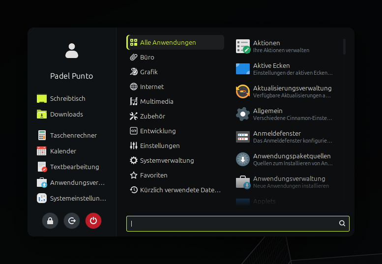</td>
    <td width="50%"></td>
  </tr>
  <tr>
    <td align="center"><b>Startmenü</b><br><sub>Lime-Balken an der gewählten Kategorie, Suche mit Lime-Rahmen</sub></td>
    <td align="center"><b>Kalender</b><br><sub>Heute in Lime, alles andere ruhig</sub></td>
  </tr>
  <tr>
    <td width="50%">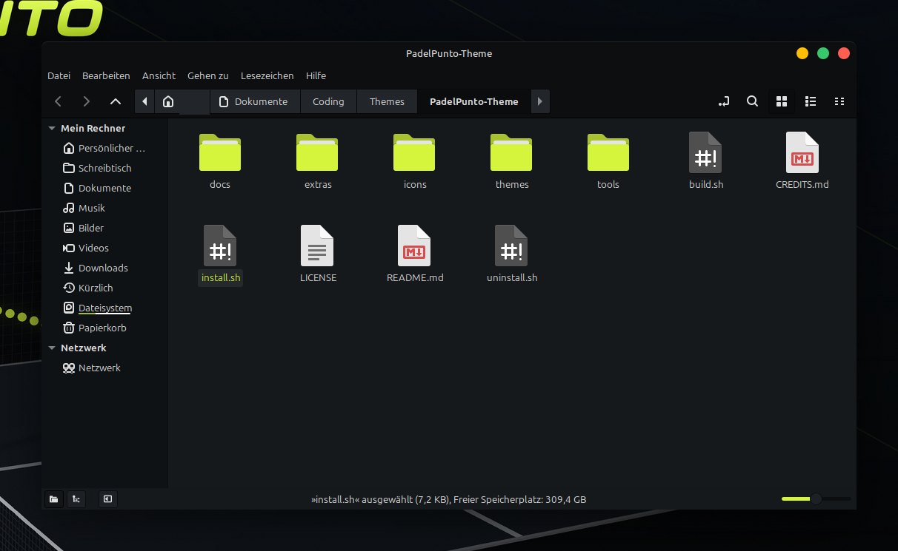</td>
    <td width="50%">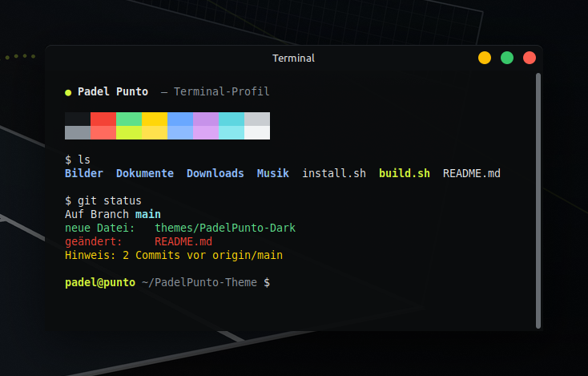</td>
  </tr>
  <tr>
    <td align="center"><b>Dateimanager</b><br><sub>Lime-Ordner, Papirus-Icons, dunkle Seitenleiste</sub></td>
    <td align="center"><b>Terminal</b><br><sub>Profil „Padel Punto“ mit eigener Palette</sub></td>
  </tr>
  <tr>
    <td width="50%">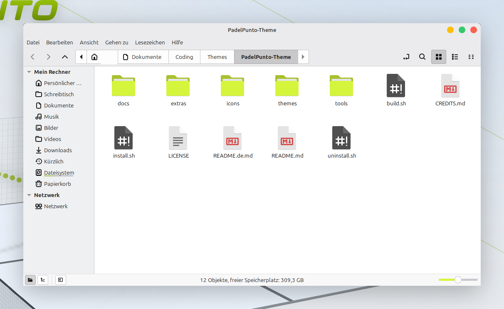</td>
    <td width="50%">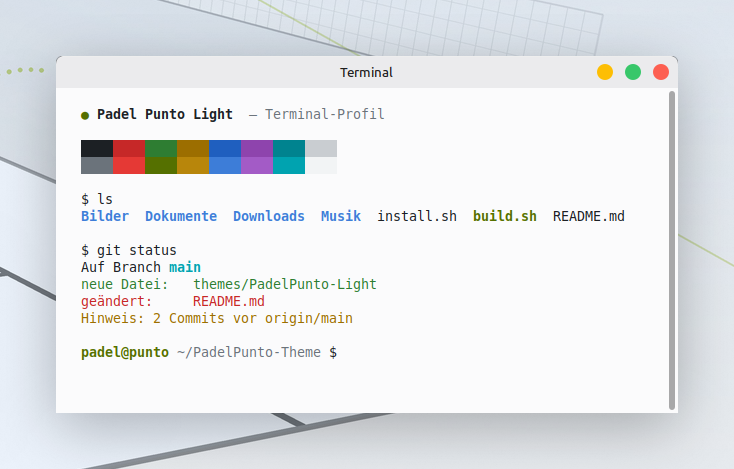</td>
  </tr>
  <tr>
    <td align="center"><b>Dateimanager · hell</b><br><sub>Dieselben Lime-Ordner auf Weiß, sanfte Lime-Auswahl</sub></td>
    <td align="center"><b>Terminal · hell</b><br><sub>Profil „Padel Punto Light“, Farben für Weiß abgestimmt</sub></td>
  </tr>
  <tr>
    <td width="50%">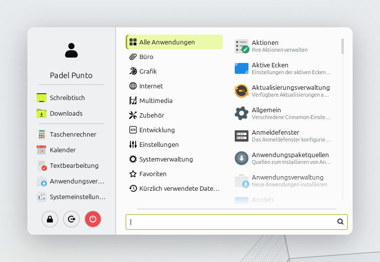</td>
    <td width="50%"></td>
  </tr>
  <tr>
    <td align="center"><b>Startmenü · hell</b><br><sub>Sanfte Lime-Markierung mit tieferem Lime-Balken</sub></td>
    <td align="center"><b>Obere Leiste & Dock</b><br><sub>Arbeitsflächen als Zahlen, die aktive als Lime-Pille</sub></td>
  </tr>
  <tr>
    <td width="50%">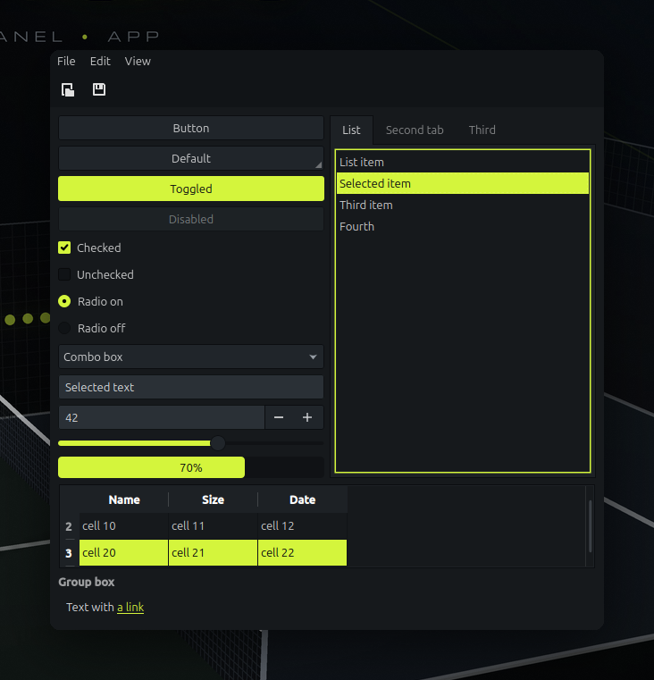</td>
    <td width="50%">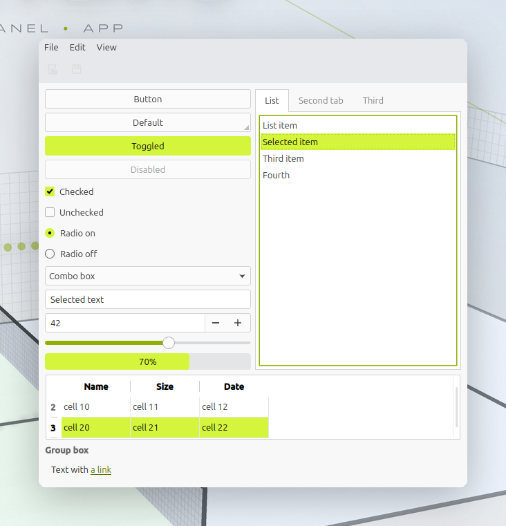</td>
  </tr>
  <tr>
    <td align="center"><b>Qt-Programme</b><br><sub>Kvantum-Theme: Lime-Auswahl und gedrückte Knöpfe mit Ink-Schrift</sub></td>
    <td align="center"><b>Qt-Programme · hell</b><br><sub>Dasselbe auf Weiß, Fokuslinien im tieferen Lime</sub></td>
  </tr>
</table>

### 🖼️ Hintergründe

<p align="center">
  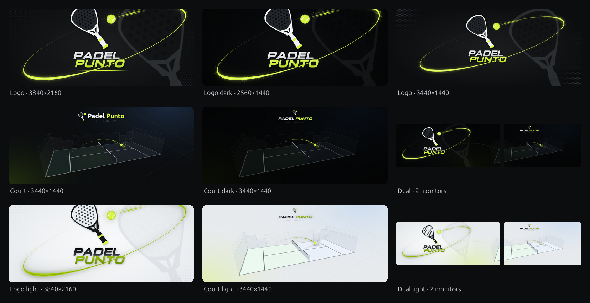
</p>

`--hintergrund` kopiert alle und wählt beim Einschalten den passenden: den Court für Ultrawide-Bildschirme,
das Logo für 16:9 – jeweils in der gewählten Variante. Bei zwei Bildschirmen reicht das Dual-Bild
über beide, der Ball fliegt von einem Bildschirm zum anderen.

### 🎨 Farben

<p align="center">
  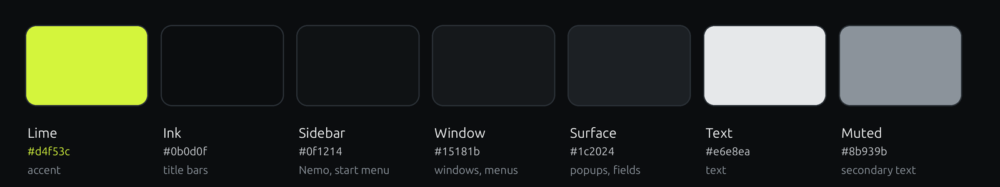
</p>

Dieselben Farben wie in der Padel-Punto-App: Lime `#d4f53c` als einziger Akzent, alles andere in abgestuftem Ink.
Die helle Variante nutzt weiße Flächen und Ink-Schrift, für Schrift und Linien das tiefere Lime `#557000`.

## 🛟 Hilfe

<details>
<summary><b>Die Fensterrahmen sehen noch alt aus</b></summary>
<br>
Cinnamon merkt sich die Rahmen bereits offener Fenster. Einmal ab- und wieder anmelden
oder Cinnamon neu laden mit <kbd>Strg</kbd> + <kbd>Alt</kbd> + <kbd>Esc</kbd>.
</details>

<details>
<summary><b>Webseiten oder Apps folgen nicht dunkel / hell</b></summary>
<br>
<code>--aktivieren</code> (steckt in <code>--alles</code>) setzt in Mint den dunklen bzw. hellen Modus, danach richten
sich Browser, Webseiten und Electron-Apps. Der Schalter liegt auch unter Systemeinstellungen → Themen.
Schon geöffnete Apps brauchen eventuell einen Neustart.
Für Flatpak-Apps zusätzlich mit <code>--flatpak</code> installieren und die App neu starten.
</details>

<details>
<summary><b>Das Dock ist zu groß oder zu klein</b></summary>
<br>
Rechtsklick auf das Dock → <b>Leisteneinstellungen</b>. Passend zur Pille sind 76 px Höhe
und 60 px Symbolgröße in der Mitte. Andere Werte gehen auch, die Pille wächst mit.
</details>

<details>
<summary><b>Double Commander hat noch die alten Farben</b></summary>
<br>
Double Commander schreibt seine Einstellungen beim Beenden zurück, die Farben lassen sich
also nur setzen, solange er geschlossen ist. Das Skript bittet dich darum. Hast du das
übersprungen: Double Commander schließen und <code>./install.sh --doublecmd</code> ausführen.
</details>

<details>
<summary><b>Ein Qt-Programm sieht noch aus wie vorher</b></summary>
<br>
Qt-Programme übernehmen das Theme beim Anmelden. Nach <code>--qt</code> also einmal ab- und wieder anmelden.
<br><br>
<b>Qt-6-Programme:</b> Linux Mint 22 hat die Kvantum-Engine nur für Qt 5 (VLC, KeePassXC und die meisten anderen).
Programme mit Qt 6 behalten dort ihren eigenen Look. Auf neueren Systemen mit
<code>qt6-style-kvantum</code> installiert das Skript es mit, dann ziehen auch Qt-6-Programme mit.
<br><br>
<b>Flatpak-Programme:</b> mit <code>--flatpak</code> installieren und die passende Kvantum-Erweiterung dazunehmen,
z. B. <code>flatpak install flathub org.kde.KStyle.Kvantum</code> (Flatpak fragt nach der Version).
</details>

<details>
<summary><b>Ich will meine alten Leisten zurück</b></summary>
<br>
<code>./uninstall.sh</code> stellt Leisten, Applets, Theme, Icons und Hintergrund so her,
wie sie vor der ersten Installation waren.
</details>

## 🧹 Entfernen

```bash
./uninstall.sh
```

Stellt deine vorherigen Einstellungen wieder her und löscht alle installierten Dateien.

<details>
<summary><b>🔧 Selbst bauen</b></summary>
<br>

`themes/`, `icons/` und `kvantum/` liegen fertig gebaut im Repo. Neu bauen lässt sich alles mit:

```bash
./build.sh
```

Die einzelnen Schritte stecken in `tools/`:

| Skript | Aufgabe |
|---|---|
| `padelpunto_theme.py` | baut die Themes aus Mint-Y-Dark und Mint-Y: Mint-Grün → Lime (hell: tieferes Lime für Schrift und Linien), Grautöne → Ink, Text auf Lime wird Ink, Auswahl mit Lime-Balken, Mac-Punkte als Fensterknöpfe |
| `papirus_lime_folders.py` | Papirus-Ordner in Lime umfärben (das helle Icon-Theme verweist auf dieselben Ordner) |
| `panels.py` | richtet obere Leiste und Dock ein, installiert die Applets „Active app“ und „Calendar (Padel Punto)“ |
| `doublecmd_colors.py` | Farben für Double Commander setzen (`--restore` stellt sie wieder her) |
| `kvantum_theme.py` | baut die Kvantum-Themes für Qt-Programme aus KvArcDark und KvArc: Arc-Blau → Lime, Grautöne → Ink, Text auf Lime wird Ink |
| `readme_images.py` | die Bilder für diese Seite |

Benötigt Python 3, Pillow, die Pakete `mint-themes` und `papirus-icon-theme` (auf Linux Mint vorinstalliert)
sowie `qt5-style-kvantum-themes`.
</details>

## 🎾 Padel Punto

Das Theme gehört zu **[Padel Punto](https://github.com/PadelPunto)**, dem Punktezähler für Padel.
Am Handgelenk zählt die Uhr-App mit: **[watch-zepp](https://github.com/PadelPunto/watch-zepp)** für Amazfit-Uhren (Zepp OS).

## 📄 Lizenz

GPL-3.0, siehe [LICENSE](LICENSE). Danke an die Projekte, auf denen dieses Theme aufbaut:
[CREDITS.md](CREDITS.md).

<p align="center"><br><sub>Gemacht für den Court und für den Schreibtisch danach. 🎾</sub></p>
