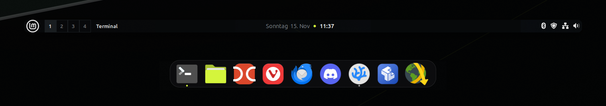
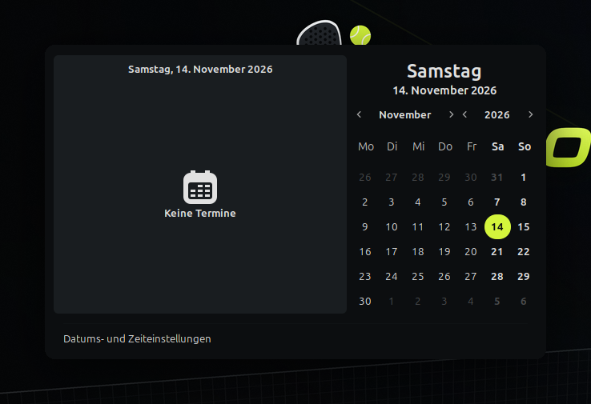
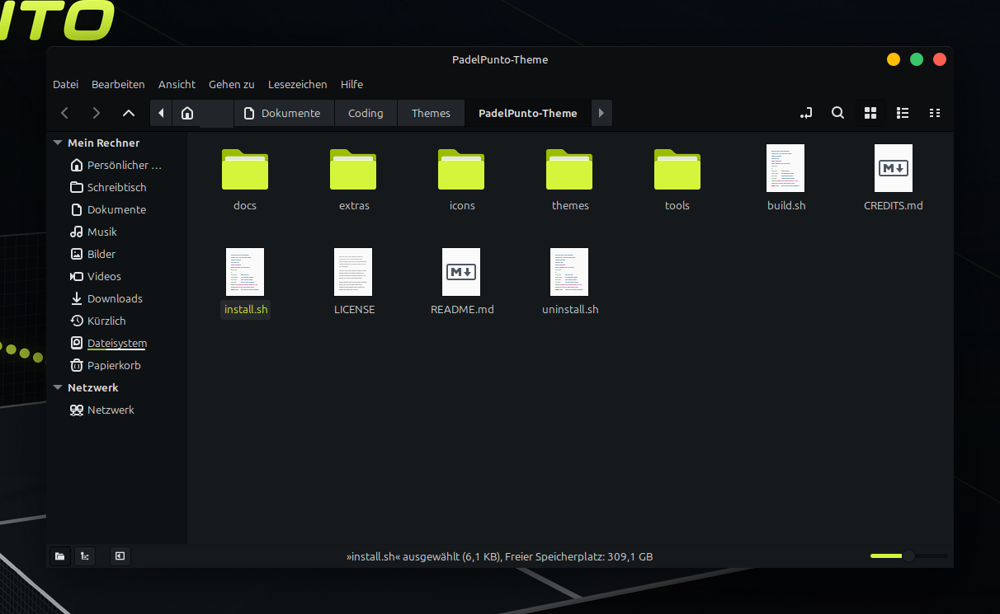

<p align="center">
  
</p>

<h1 align="center">Padel Punto · Desktop-Theme</h1>

<p align="center"><a href="README.md">English</a> · <b>Deutsch</b></p>

<p align="center">
  <b>Ink-Schwarz trifft Lime.</b> Ein dunkles Komplett-Theme für Linux Mint (Cinnamon):<br>
  Fenster, Leisten, Dock, Icons, Terminal und Hintergründe in den Farben von Padel Punto.
</p>

<p align="center">
  
  
  
  
  <a href="https://github.com/PadelPunto"></a>
</p>

<p align="center">
  <a href="#-installieren">Installieren</a> ·
  <a href="#-wo-finde-ich-was">Wo finde ich was?</a> ·
  <a href="#-bilder">Bilder</a> ·
  <a href="#-hilfe">Hilfe</a> ·
  <a href="#-entfernen">Entfernen</a>
</p>

<p align="center">
  
</p>

## ✨ Das ist drin

<table>
  <tr>
    <td width="50%" valign="top">
      <h3>🖥️ Theme</h3>
      Fenster, Menüs, Startmenü, Benachrichtigungen und Alt-Tab in tiefem Ink mit Lime-Akzent.
      Ausgewählte Einträge bekommen einen schmalen Lime-Balken, die Fensterknöpfe sind bunte Mac-Punkte.
      Gilt für alte und neue Programme (GTK 2, GTK 3, GTK 4 und libadwaita).
    </td>
    <td width="50%" valign="top">
      <h3>📁 Icons</h3>
      Auf Basis von Papirus-Dark: moderne, flache Icons für fast jede App und jeden Dateityp.
      Die Ordner leuchten in Lime, Musik, Bilder, Downloads & Co. behalten ihre Symbole.
    </td>
  </tr>
  <tr>
    <td width="50%" valign="top">
      <h3>⚓ Dock & obere Leiste</h3>
      Unten ein Dock mit schwebender Pille und Punkten unter laufenden Programmen.
      Oben eine schmale Leiste mit Menü, Arbeitsflächen, aktivem Programm und der Uhr
      mit Lime-Punkt in der Mitte. Deine angehefteten Programme bleiben erhalten.
    </td>
    <td width="50%" valign="top">
      <h3>⌨️ Terminal, Double Commander & Hintergründe</h3>
      Ein Terminal-Profil mit Lime-Cursor und abgestimmter Farbpalette,
      Ink & Lime für Double Commander und vier Padel-Punto-Hintergründe bis 3840×2160.
    </td>
  </tr>
</table>

<p align="center">
  
</p>

## 🚀 Installieren

> **Voraussetzung:** Linux Mint mit Cinnamon (getestet mit Mint 22.3 und Cinnamon 6.6).
> Alles landet nur in deinem Benutzerordner, ein Passwort oder `sudo` ist nicht nötig.

**1. Herunterladen.** Mit git:

```bash
git clone https://github.com/fat-toni/PadelPunto-Theme
cd PadelPunto-Theme
```

<sub>Ohne git: oben auf dieser Seite **Code → Download ZIP**, die Datei entpacken,
den Ordner öffnen, Rechtsklick in eine freie Stelle → **Im Terminal öffnen**.</sub>

**2. Installieren und einschalten:**

```bash
./install.sh --alles
```

**3. Fertig.** Das Theme ist sofort aktiv. Damit wirklich alles umschaltet, auch die Fensterrahmen
und schon geöffnete Programme, einmal **ab- und wieder anmelden**.

Deine bisherigen Einstellungen merkt sich das Skript. `./uninstall.sh` holt sie jederzeit zurück.

<details>
<summary><b>Nur einzelne Teile installieren</b></summary>
<br>

Statt `--alles` lassen sich die Teile einzeln wählen und kombinieren:

| Option | Was passiert |
|---|---|
| *(keine)* | Theme und Icons nur kopieren, nichts umschalten. Auswählen dann selbst unter **Systemeinstellungen → Themen** |
| `--aktivieren` | Theme und Icons einschalten, dunkler Modus für alle Apps, Padel-Punto-Farben auch für neuere GNOME-Apps |
| `--dock` | obere Leiste (32 px) und Dock (76 px) wie auf den Bildern einrichten |
| `--terminal` | Terminal-Profil „Padel Punto“ anlegen (mit `--aktivieren` als Standard) |
| `--doublecmd` | Double Commander in Ink & Lime (Double Commander vorher schließen) |
| `--flatpak` | Flatpak-Apps dürfen Theme, Icons und Farben lesen (nur Lesezugriff) |
| `--hintergrund` | Hintergründe kopieren (mit `--aktivieren` passend zur Bildschirmgröße setzen) |
| `--alles` | alles zusammen |

Beispiel: nur Theme und Terminal, sofort aktiv:

```bash
./install.sh --aktivieren --terminal
```

Wichtig: Bei jedem Aufruf wird das Theme frisch kopiert. Gib deshalb immer **alle** Teile an,
die du haben willst, sonst fehlt zum Beispiel das Dock-Styling.
</details>

<details>
<summary><b>Aktualisieren</b></summary>
<br>

```bash
cd PadelPunto-Theme
git pull
./install.sh --alles
```

Danach einmal ab- und wieder anmelden.
</details>

## 🧭 Wo finde ich was?

Nach der Installation findest du alles an den gewohnten Stellen in Linux Mint:

| Was | Wo |
|---|---|
| **Theme & Icons** | Systemeinstellungen → **Themen**. Fensterrahmen, Steuerelemente und Desktop: `PadelPunto-Dark`, Symbole: `PadelPunto` |
| **Hintergründe** | Systemeinstellungen → **Hintergründe** → Ordner `padelpunto` in der linken Liste |
| **Leiste & Dock** | Rechtsklick auf die Leiste → **Leisteneinstellungen** (Höhe, Symbolgröße, automatisch ausblenden) |
| **Uhr & aktives Programm** | Systemeinstellungen → **Applets**: „Kalender (Padel Punto)“ und „Aktives Programm (Padel Punto)“ |
| **Terminal-Profil** | Terminal → Menü → **Einstellungen** → Profil „Padel Punto“ |
| **Double Commander** | wird direkt umgefärbt, zu finden unter Konfiguration → Optionen → Farben |

<details>
<summary><b>Wo die Dateien liegen</b></summary>
<br>

| Datei | Ort |
|---|---|
| Theme | `~/.themes/PadelPunto-Dark` |
| Icons | `~/.local/share/icons/PadelPunto` |
| Applets | `~/.local/share/cinnamon/applets/` (`kalender@padelpunto`, `aktives-programm@padelpunto`) |
| Hintergründe | `~/.local/share/backgrounds/padelpunto` |
| Farben für neuere GNOME-Apps | `~/.config/gtk-4.0/gtk.css` (nur mit `--flatpak` oder ohne Mint-libadwaita) |
| Gemerkte alte Einstellungen | `~/.local/share/padelpunto-theme/vorher.txt` |
</details>

## 📸 Bilder

<table>
  <tr>
    <td width="50%"></td>
    <td width="50%"></td>
  </tr>
  <tr>
    <td align="center"><b>Startmenü</b><br><sub>Lime-Balken an der gewählten Kategorie, Suche mit Lime-Rahmen</sub></td>
    <td align="center"><b>Kalender</b><br><sub>Heute in Lime, alles andere ruhig</sub></td>
  </tr>
  <tr>
    <td width="50%"></td>
    <td width="50%"></td>
  </tr>
  <tr>
    <td align="center"><b>Dateimanager</b><br><sub>Lime-Ordner, Papirus-Icons, dunkle Seitenleiste</sub></td>
    <td align="center"><b>Terminal</b><br><sub>Profil „Padel Punto“ mit eigener Palette</sub></td>
  </tr>
</table>

### 🎨 Farben

<p align="center">
  
</p>

Dieselben Farben wie in der Padel-Punto-App: Lime `#d4f53c` als einziger Akzent, alles andere in abgestuftem Ink.

## 🛟 Hilfe

<details>
<summary><b>Die Fensterrahmen sehen noch alt aus</b></summary>
<br>
Cinnamon merkt sich die Rahmen bereits offener Fenster. Einmal ab- und wieder anmelden
oder Cinnamon neu laden mit <kbd>Strg</kbd> + <kbd>Alt</kbd> + <kbd>Esc</kbd>.
</details>

<details>
<summary><b>Webseiten oder Apps bleiben hell</b></summary>
<br>
<code>--aktivieren</code> (steckt in <code>--alles</code>) schaltet in Mint „Dunklen Modus bevorzugen“ ein, danach richten
sich Browser, Webseiten und Electron-Apps. Der Schalter liegt auch unter Systemeinstellungen → Themen.
Für Flatpak-Apps zusätzlich mit <code>--flatpak</code> installieren und die App neu starten.
</details>

<details>
<summary><b>Das Dock ist zu groß oder zu klein</b></summary>
<br>
Rechtsklick auf das Dock → <b>Leisteneinstellungen</b>. Passend zur Pille sind 76 px Höhe
und 60 px Symbolgröße in der Mitte. Andere Werte gehen auch, die Pille wächst mit.
</details>

<details>
<summary><b>„Double Commander läuft noch“</b></summary>
<br>
Double Commander schreibt seine Einstellungen beim Beenden zurück. Erst schließen, dann
<code>python3 tools/doublecmd_farben.py</code> ausführen (oder <code>install.sh</code> noch einmal).
</details>

<details>
<summary><b>Ich will meine alten Leisten zurück</b></summary>
<br>
<code>./uninstall.sh</code> stellt Leisten, Applets, Theme, Icons und Hintergrund so her,
wie sie vor der ersten Installation waren.
</details>

## 🧹 Entfernen

```bash
./uninstall.sh
```

Stellt deine vorherigen Einstellungen wieder her und löscht alle installierten Dateien.

<details>
<summary><b>🔧 Selbst bauen</b></summary>
<br>

`themes/` und `icons/` liegen fertig gebaut im Repo. Neu bauen lässt sich alles mit:

```bash
./build.sh
```

Die einzelnen Schritte stecken in `tools/`:

| Skript | Aufgabe |
|---|---|
| `padelpunto_theme.py` | baut das Theme aus Mint-Y-Dark: Mint-Grün → Lime, Grautöne → Ink, Text auf Lime wird Ink, Auswahl mit Lime-Balken, Mac-Punkte als Fensterknöpfe |
| `lime_ordner_papirus.py` | Papirus-Ordner in Lime umfärben |
| `leisten.py` | richtet obere Leiste und Dock ein, installiert die Applets „Aktives Programm“ und „Kalender (Padel Punto)“ |
| `doublecmd_farben.py` | Farben für Double Commander setzen (`--zurueck` stellt sie wieder her) |
| `readme_bilder.py` | die Bilder für diese Seite |

Benötigt Python 3, Pillow und die Pakete `mint-themes` und `papirus-icon-theme` (auf Linux Mint vorinstalliert).
</details>

## 🎾 Padel Punto

Das Theme gehört zu **[Padel Punto](https://github.com/PadelPunto)**, dem Punktezähler für Padel.
Am Handgelenk zählt die Uhr-App mit: **[watch-zepp](https://github.com/PadelPunto/watch-zepp)** für Amazfit-Uhren (Zepp OS).

## 📄 Lizenz

GPL-3.0, siehe [LICENSE](LICENSE). Danke an die Projekte, auf denen dieses Theme aufbaut:
[CREDITS.md](CREDITS.md).

<p align="center"><br><sub>Gemacht für den Court und für den Schreibtisch danach. 🎾</sub></p>
