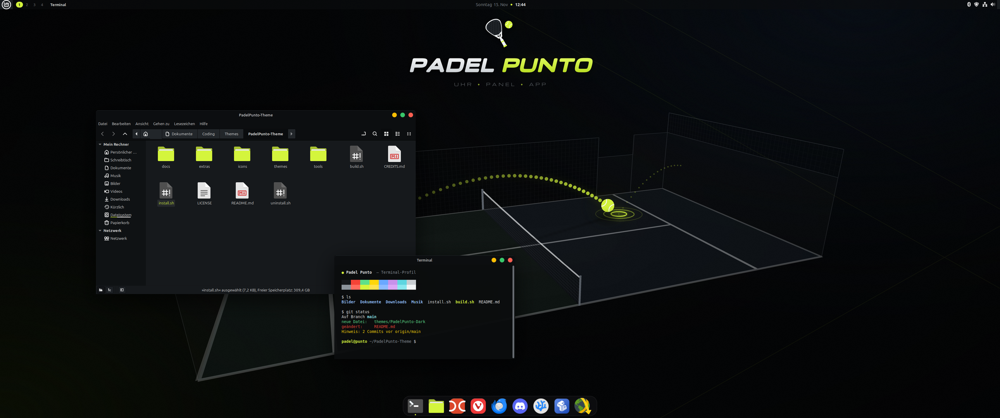
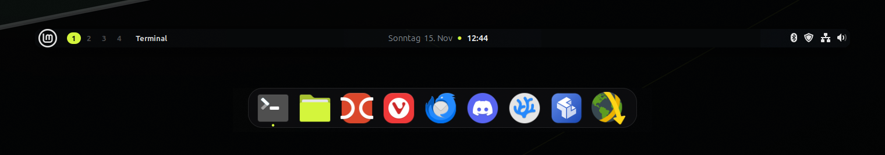
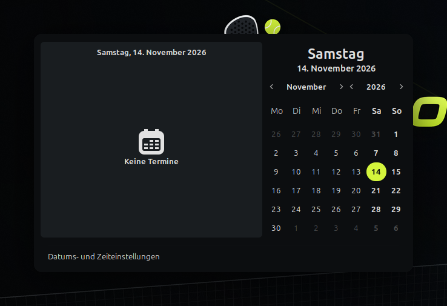
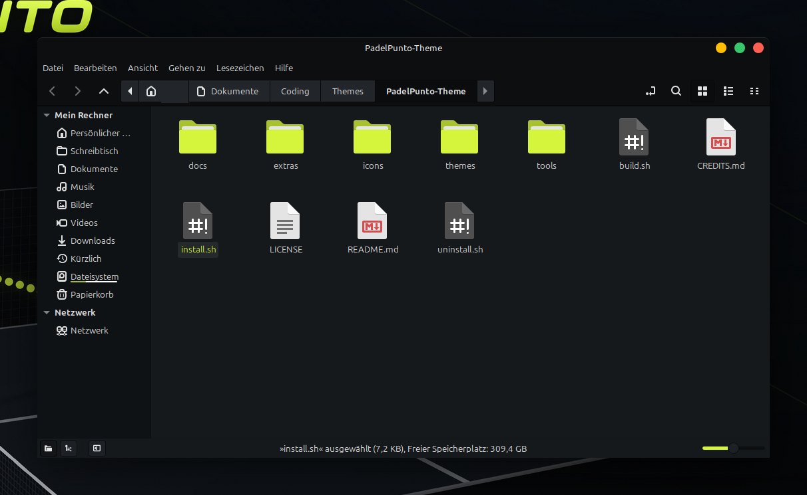
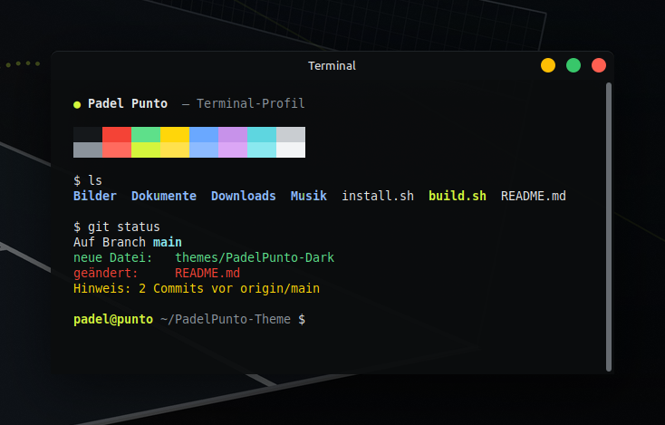

<p align="center">
  
</p>

<h1 align="center">Padel Punto · Desktop Theme</h1>

<p align="center"><b>English</b> · <a href="README.de.md">Deutsch</a></p>

<p align="center">
  <b>Ink black meets lime.</b> A complete dark theme for Linux Mint (Cinnamon):<br>
  windows, panels, dock, icons, terminal and wallpapers in the colors of Padel Punto.
</p>

<p align="center">
  
  
  
  
  <a href="https://github.com/PadelPunto"></a>
</p>

<p align="center">
  <a href="#-install">Install</a> ·
  <a href="#-where-to-find-things">Where to find things</a> ·
  <a href="#-screenshots">Screenshots</a> ·
  <a href="#-help">Help</a> ·
  <a href="#-uninstall">Uninstall</a>
</p>

<p align="center">
  
</p>

## ✨ What's inside

<table>
  <tr>
    <td width="50%" valign="top">
      <h3>🖥️ Theme</h3>
      Windows, menus, start menu, notifications and Alt-Tab in deep ink with a lime accent.
      Selected items get a slim lime bar, the window buttons are colorful Mac-style dots.
      Works for old and new apps alike (GTK 2, GTK 3, GTK 4 and libadwaita).
    </td>
    <td width="50%" valign="top">
      <h3>📁 Icons</h3>
      Based on Papirus-Dark: modern flat icons for almost every app and file type.
      Folders glow in lime, while Music, Pictures, Downloads & co. keep their symbols.
    </td>
  </tr>
  <tr>
    <td width="50%" valign="top">
      <h3>⚓ Dock & top panel</h3>
      A dock at the bottom with a floating pill and dots under running apps.
      A slim top panel with menu, workspaces (the active one as a lime pill), active app
      and a clock with a lime dot in the middle. Your pinned apps are kept.
      Switch workspaces with <kbd>Ctrl</kbd> + <kbd>Alt</kbd> + <kbd>←</kbd> / <kbd>→</kbd>,
      overview with <kbd>Ctrl</kbd> + <kbd>Alt</kbd> + <kbd>↑</kbd>.
    </td>
    <td width="50%" valign="top">
      <h3>⌨️ Terminal, Double Commander & wallpapers</h3>
      A terminal profile with lime cursor and matching palette,
      ink & lime for Double Commander and four Padel Punto wallpapers up to 3840×2160.
    </td>
  </tr>
</table>

<p align="center">
  
</p>

## 🚀 Install

> **Requirements:** Linux Mint with Cinnamon (tested with Mint 22.3 and Cinnamon 6.6).
> Everything goes into your home folder only, no password or `sudo` needed.

**1. Download.** With git:

```bash
git clone https://github.com/fat-toni/PadelPunto-Theme
cd PadelPunto-Theme
```

<sub>Without git: click **Code → Download ZIP** at the top of this page, extract it,
open the folder, right-click an empty spot → **Open in Terminal**.</sub>

**2. Install and switch it on:**

```bash
./install.sh --all
```

**3. Done.** The theme is active right away. To make sure everything switches over,
including window borders and apps that are already open, **log out and back in** once.

The script remembers your previous settings. `./uninstall.sh` brings them back at any time.

<details>
<summary><b>Install only some parts</b></summary>
<br>

Instead of `--all` you can pick and combine the parts:

| Option | What it does |
|---|---|
| *(none)* | only copy theme and icons, change nothing. Pick them yourself under **System Settings → Themes** |
| `--activate` | switch theme and icons on, dark mode for all apps, Padel Punto colors for newer GNOME apps too |
| `--dock` | set up the top panel (32 px) and dock (76 px) as in the screenshots |
| `--terminal` | add the terminal profile “Padel Punto” (made the default with `--activate`) |
| `--doublecmd` | ink & lime for Double Commander (close Double Commander first) |
| `--flatpak` | let Flatpak apps read the theme, icons and colors (read-only) |
| `--wallpaper` | copy the wallpapers (with `--activate`, set one that fits your screen) |
| `--all` | all of the above |

Example: only theme and terminal, active right away:

```bash
./install.sh --activate --terminal
```

Important: every run copies the theme fresh. So always pass **all** the parts you want,
otherwise the dock styling, for example, will be missing.

<sub>The German option names (`--alles`, `--aktivieren`, `--hintergrund`) work as well.</sub>
</details>

<details>
<summary><b>Update</b></summary>
<br>

```bash
cd PadelPunto-Theme
git pull
./install.sh --all
```

Then log out and back in once.
</details>

## 🧭 Where to find things

After installing, everything sits in the usual places in Linux Mint:

| What | Where |
|---|---|
| **Theme & icons** | System Settings → **Themes**. Window borders, Controls and Desktop: `PadelPunto-Dark`, Icons: `PadelPunto` |
| **Wallpapers** | System Settings → **Backgrounds** → folder `padelpunto` in the list on the left |
| **Panel & dock** | right-click the panel → **Panel settings** (height, icon size, auto-hide) |
| **Clock & active app** | System Settings → **Applets**: “Calendar (Padel Punto)” and “Active app (Padel Punto)” |
| **Terminal profile** | Terminal → menu → **Preferences** → profile “Padel Punto” |
| **Double Commander** | recolored directly, see Configuration → Options → Colors |

<details>
<summary><b>Where the files live</b></summary>
<br>

| File | Location |
|---|---|
| Theme | `~/.themes/PadelPunto-Dark` |
| Icons | `~/.local/share/icons/PadelPunto` |
| Applets | `~/.local/share/cinnamon/applets/` (`calendar@padelpunto`, `active-app@padelpunto`) |
| Wallpapers | `~/.local/share/backgrounds/padelpunto` |
| Colors for newer GNOME apps | `~/.config/gtk-4.0/gtk.css` (only with `--flatpak` or without Mint's libadwaita) |
| Saved previous settings | `~/.local/share/padelpunto-theme/previous.txt` |
</details>

## 📸 Screenshots

<table>
  <tr>
    <td width="50%"></td>
    <td width="50%"></td>
  </tr>
  <tr>
    <td align="center"><b>Start menu</b><br><sub>Lime bar on the selected category, search with lime border</sub></td>
    <td align="center"><b>Calendar</b><br><sub>Today in lime, everything else calm</sub></td>
  </tr>
  <tr>
    <td width="50%"></td>
    <td width="50%"></td>
  </tr>
  <tr>
    <td align="center"><b>File manager</b><br><sub>Lime folders, Papirus icons, dark sidebar</sub></td>
    <td align="center"><b>Terminal</b><br><sub>Profile “Padel Punto” with its own palette</sub></td>
  </tr>
</table>

<sub>The screenshots show a German desktop, the theme works with any language.</sub>

### 🎨 Colors

<p align="center">
  
</p>

The same colors as in the Padel Punto app: lime `#d4f53c` as the only accent, everything else in shades of ink.

## 🛟 Help

<details>
<summary><b>Window borders still look old</b></summary>
<br>
Cinnamon caches the borders of windows that are already open. Log out and back in,
or reload Cinnamon with <kbd>Ctrl</kbd> + <kbd>Alt</kbd> + <kbd>Esc</kbd>.
</details>

<details>
<summary><b>Websites or apps stay light</b></summary>
<br>
<code>--activate</code> (part of <code>--all</code>) turns on Mint's dark mode preference, which browsers,
websites and Electron apps follow. You can also find it under System Settings → Themes → “Prefer dark mode”.
For Flatpak apps also install with <code>--flatpak</code> and restart the app.
</details>

<details>
<summary><b>The dock is too big or too small</b></summary>
<br>
Right-click the dock → <b>Panel settings</b>. The pill fits best with 76 px height
and 60 px icon size in the center zone. Other sizes work too, the pill grows with them.
</details>

<details>
<summary><b>“Double Commander is still running”</b></summary>
<br>
Double Commander writes its settings back when it quits. Close it first, then run
<code>python3 tools/doublecmd_colors.py</code> (or <code>install.sh</code> again).
</details>

<details>
<summary><b>I want my old panels back</b></summary>
<br>
<code>./uninstall.sh</code> restores panels, applets, theme, icons and wallpaper
as they were before the first install.
</details>

## 🧹 Uninstall

```bash
./uninstall.sh
```

Restores your previous settings and removes all installed files.

<details>
<summary><b>🔧 Build it yourself</b></summary>
<br>

`themes/` and `icons/` are included ready-built. To rebuild everything:

```bash
./build.sh
```

The individual steps live in `tools/`:

| Script | Job |
|---|---|
| `padelpunto_theme.py` | builds the theme from Mint-Y-Dark: Mint green → lime, greys → ink, text on lime becomes ink, selection with lime bar, Mac-style window buttons |
| `papirus_lime_folders.py` | recolors the Papirus folders to lime |
| `panels.py` | sets up top panel and dock, installs the applets “Active app” and “Calendar (Padel Punto)” |
| `doublecmd_colors.py` | sets the Double Commander colors (`--restore` brings the old ones back) |
| `readme_images.py` | the images for this page |

Needs Python 3, Pillow and the packages `mint-themes` and `papirus-icon-theme` (preinstalled on Linux Mint).
</details>

## 🎾 Padel Punto

This theme belongs to **[Padel Punto](https://github.com/PadelPunto)**, the score counter for padel.
On your wrist the watch app keeps score: **[watch-zepp](https://github.com/PadelPunto/watch-zepp)** for Amazfit watches (Zepp OS).

## 📄 License

GPL-3.0, see [LICENSE](LICENSE). Thanks to the projects this theme builds on:
[CREDITS.md](CREDITS.md).

<p align="center"><br><sub>Made for the court, and for the desk afterwards. 🎾</sub></p>
