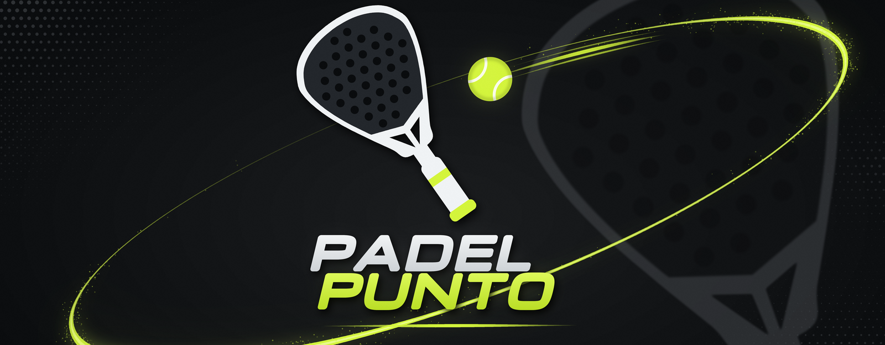
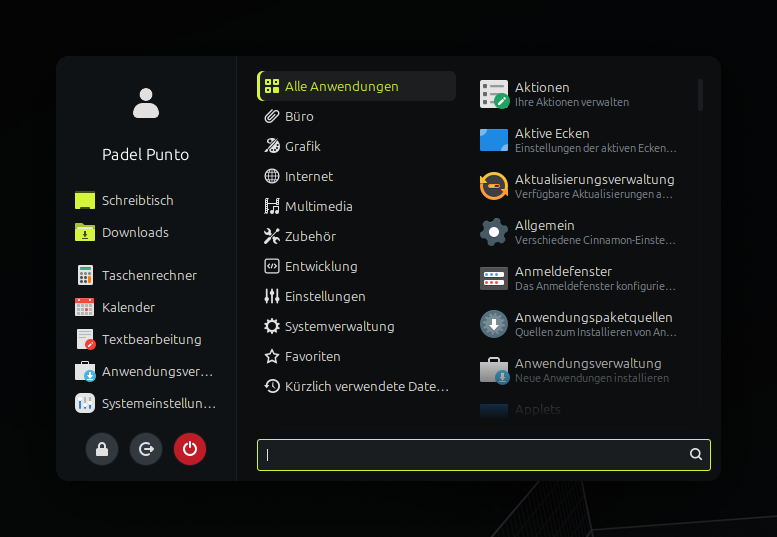

<p align="center">
  
</p>

<h1 align="center">Padel Punto · Desktop-Theme</h1>

<p align="center">
  <b>Ink-Schwarz trifft Lime.</b> Ein dunkles Theme für Linux Mint / Cinnamon –<br>
  vom Startmenü über den Dateimanager bis zum Terminal in den Farben von Padel Punto.
</p>

<p align="center">
  
  
  
  
  <a href="https://github.com/PadelPunto"></a>
</p>

<p align="center">
  <a href="#-installieren">Installieren</a> ·
  <a href="#-so-sieht-es-aus">Bilder</a> ·
  <a href="#-farben">Farben</a> ·
  <a href="#-entfernen">Entfernen</a> ·
  <a href="#-padel-punto">Padel Punto</a>
</p>

<br>

<p align="center">
  
</p>

<br>

## ✨ Was du bekommst

<table>
  <tr>
    <td width="50%" valign="top">
      <h3>🖥️ Theme <code>PadelPunto-Dark</code></h3>
      Fenster, Dateimanager, Leisten, Menüs, Startmenü, Benachrichtigungen und Alt-Tab –
      alles in tiefem Ink mit Lime-Akzent, von alten GTK2-Programmen bis zu neuen libadwaita-Apps.
      Ausgewählte Einträge bekommen einen schmalen
      Lime-Balken statt einer bunten Fläche.
    </td>
    <td width="50%" valign="top">
      <h3>📁 Icons <code>PadelPunto</code></h3>
      Auf Basis von Papirus-Dark: flache, moderne Icons für fast jede App und jeden
      Dateityp. Die Ordner leuchten in Lime, Musik, Bilder, Downloads & Co. behalten ihre Symbole.
    </td>
  </tr>
  <tr>
    <td width="50%" valign="top">
      <h3>⚓ Dock & Leiste <sub>optional</sub></h3>
      Unten ein Dock mit schwebender Pille, Punkten unter laufenden Programmen und
      runder Hover-Kachel. Oben eine schmale Leiste: Menü, Arbeitsflächen, aktives
      Programm, in der Mitte die Uhr mit Lime-Punkt.
    </td>
    <td width="50%" valign="top">
      <h3>⌨️ Terminal & Hintergründe <sub>optional</sub></h3>
      Ein GNOME-Terminal-Profil mit Lime-Cursor und abgestimmter Farbpalette,
      passende Farben für Double Commander und die Padel-Punto-Hintergründe bis 3840×2160.
    </td>
  </tr>
</table>

## 🚀 Installieren

```bash
git clone https://github.com/fat-toni/PadelPunto-Theme
cd PadelPunto-Theme
./install.sh --alles
```

Fertig – alles landet nur in deinem Benutzerordner, `sudo` ist nicht nötig.
Deine bisherigen Einstellungen merkt sich das Skript, `./uninstall.sh` holt sie zurück.

<details>
<summary><b>Nur einzelne Teile installieren</b></summary>
<br>

| Option | Was passiert |
|---|---|
| *(keine)* | Theme und Icons kopieren, nichts umschalten |
| `--aktivieren` | Theme und Icons direkt einschalten, dunkler Modus für alle Apps, Padel-Punto-Farben auch für neuere GNOME-Apps (libadwaita) |
| `--dock` | Leisten wie auf den Bildern: oben 32 px mit Menü, Arbeitsflächen, aktivem Programm und Uhr, unten das Dock (76 px) mit Pille, Punkten und Hover. Angeheftete Programme bleiben erhalten |
| `--terminal` | Terminal-Profil „Padel Punto“ anlegen (mit `--aktivieren` als Standard) |
| `--doublecmd` | Double Commander in Ink & Lime: Dateilisten, Cursor mit Lime-Rahmen, markierte Dateien in Lime (Double Commander vorher schließen) |
| `--flatpak` | Flatpak-Apps dürfen Theme, Icons und libadwaita-Farben lesen (nur Lesezugriff, gilt für alle Flatpaks) |
| `--hintergrund` | Hintergründe kopieren (mit `--aktivieren` passend zur Bildschirmgröße setzen) |
| `--alles` | alles zusammen |

Beispiel: nur Theme und Terminal, sofort aktiv:

```bash
./install.sh --aktivieren --terminal
```
</details>

## 📸 So sieht es aus

<table>
  <tr>
    <td width="50%"></td>
    <td width="50%"></td>
  </tr>
  <tr>
    <td align="center"><b>Startmenü</b><br><sub>Lime-Balken an der gewählten Kategorie, Suche mit Lime-Rahmen</sub></td>
    <td align="center"><b>Kalender</b><br><sub>Heute in Lime, alles andere ruhig</sub></td>
  </tr>
  <tr>
    <td width="50%"></td>
    <td width="50%"></td>
  </tr>
  <tr>
    <td align="center"><b>Dateimanager</b><br><sub>Lime-Ordner, dunkle Seitenleiste</sub></td>
    <td align="center"><b>Terminal</b><br><sub>Profil „Padel Punto“ mit eigener Palette</sub></td>
  </tr>
</table>

## 🎨 Farben

<p align="center">
  
</p>

Dieselben Farben wie in der Padel-Punto-App – Lime `#d4f53c` als einziger Akzent,
alles andere in abgestuftem Ink.

## 🧹 Entfernen

```bash
./uninstall.sh
```

Stellt deine vorherigen Einstellungen wieder her und löscht alle installierten Dateien.

<details>
<summary><b>🔧 Selbst bauen</b></summary>
<br>

`themes/` und `icons/` liegen fertig gebaut im Repo. Neu bauen lässt sich alles mit:

```bash
./build.sh
```

Die einzelnen Schritte stecken in `tools/`:

| Skript | Aufgabe |
|---|---|
| `padelpunto_theme.py` | baut das Theme aus Mint-Y-Dark: Mint-Grün → Lime, Grautöne → Ink, Text auf Lime wird Ink, Auswahl mit Lime-Balken, Mac-Punkte als Fensterknöpfe |
| `doublecmd_farben.py` | Farben für Double Commander setzen (`--zurueck` stellt sie wieder her) |
| `leisten.py` | richtet obere Leiste und Dock ein (von `install.sh --dock` aufgerufen), installiert die Applets „Aktives Programm“ und „Kalender (Padel Punto)“ |
| `lime_ordner_papirus.py` | Papirus-Ordner in Lime umfärben |
| `readme_bilder.py` | die Bilder für diese Seite |

Benötigt Python 3, Pillow und die Pakete `mint-themes` und `papirus-icon-theme` (auf Linux Mint vorinstalliert).
</details>

## 🎾 Padel Punto

Das Theme gehört zu **[Padel Punto](https://github.com/PadelPunto)**, dem Punktezähler für Padel.
Am Handgelenk zählt die Uhr-App mit: **[watch-zepp](https://github.com/PadelPunto/watch-zepp)** für Amazfit-Uhren (Zepp OS).

## 📄 Lizenz

GPL-3.0 – siehe [LICENSE](LICENSE). Danke an die Projekte, auf denen dieses Theme aufbaut:
[CREDITS.md](CREDITS.md).

<p align="center"><br><sub>Gemacht für den Court – und für den Schreibtisch danach. 🎾</sub></p>