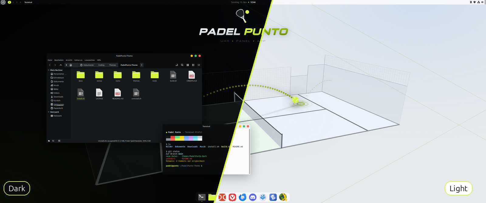
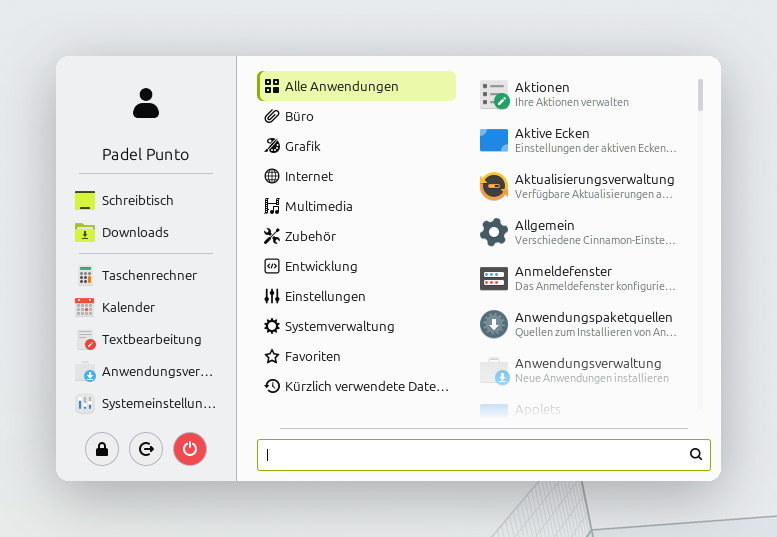
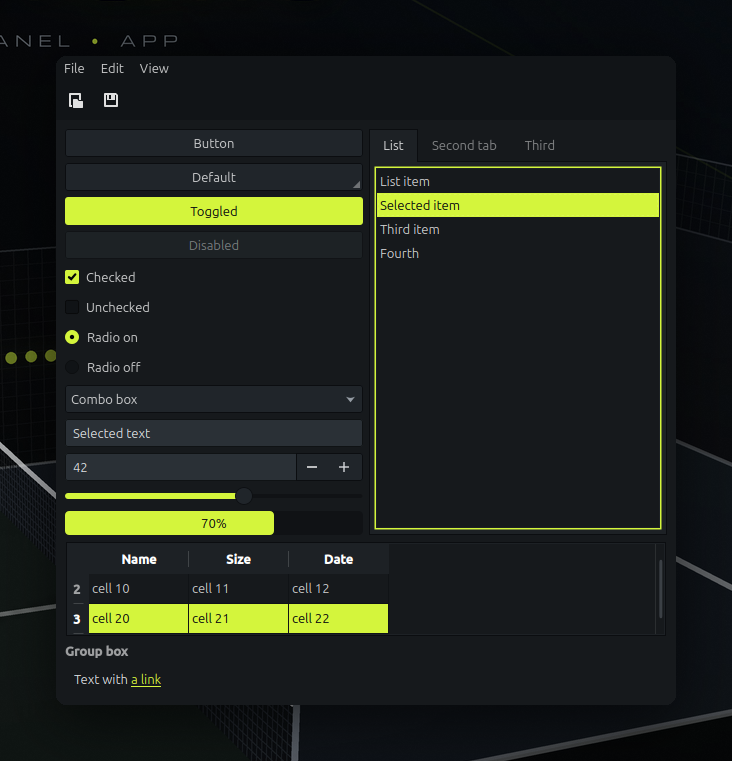
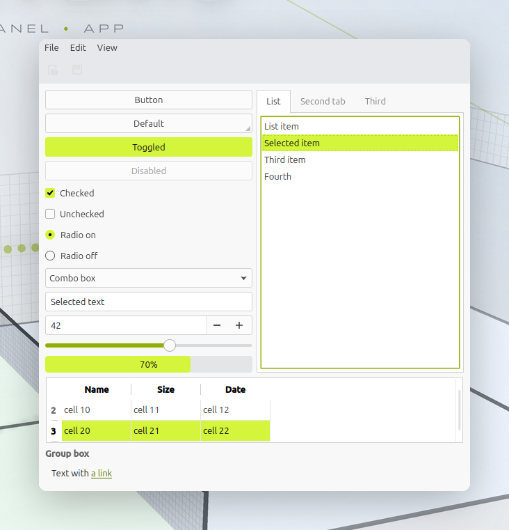
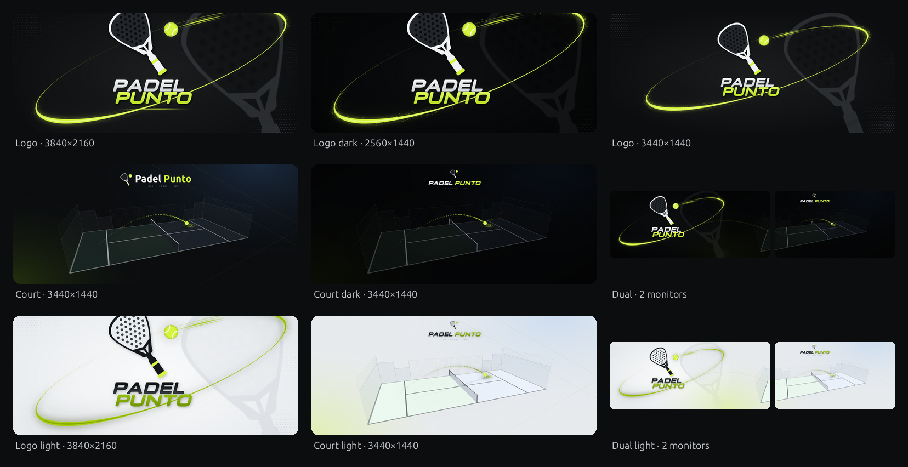
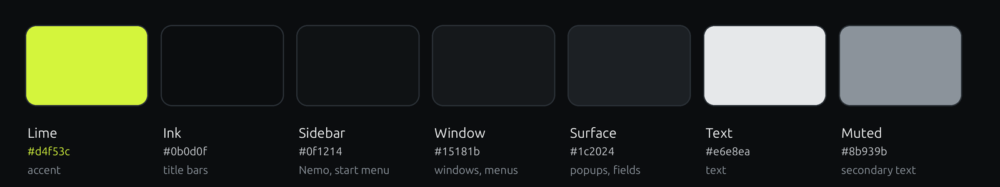

<p align="center">
  
</p>

<h1 align="center">Padel Punto · Desktop Theme</h1>

<p align="center"><b>English</b> · <a href="README.de.md">Deutsch</a></p>

<p align="center">
  <b>Ink black meets lime.</b> A complete theme for Linux Mint (Cinnamon), dark or light:<br>
  windows, panels, dock, icons, terminal, Qt apps and wallpapers in the colors of Padel Punto.
</p>

<p align="center">
  
  
  
  
  <a href="https://github.com/PadelPunto"></a>
</p>

<p align="center">
  <a href="#-dark--light">Dark & light</a> ·
  <a href="#-install">Install</a> ·
  <a href="#-where-to-find-things">Where to find things</a> ·
  <a href="#-screenshots">Screenshots</a> ·
  <a href="#-help">Help</a> ·
  <a href="#-uninstall">Uninstall</a>
</p>

<p align="center">
  
</p>

## ✨ What's inside

<table>
  <tr>
    <td width="50%" valign="top">
      <h3>🖥️ Theme</h3>
      Windows, menus, start menu, notifications and Alt-Tab in deep ink (or bright white) with a lime accent.
      Selected items get a slim lime bar, the window buttons are colorful Mac-style dots.
      Works for old and new apps alike (GTK 2, GTK 3, GTK 4 and libadwaita).
    </td>
    <td width="50%" valign="top">
      <h3>📁 Icons</h3>
      Based on Papirus (Dark / Light): modern flat icons for almost every app and file type.
      Folders glow in lime, while Music, Pictures, Downloads & co. keep their symbols.
    </td>
  </tr>
  <tr>
    <td width="50%" valign="top">
      <h3>⚓ Dock & top panel</h3>
      A dock at the bottom with a floating pill and dots under running apps.
      A slim top panel with menu, workspaces (the active one as a lime pill), active app
      and a clock with a lime dot in the middle. Your pinned apps are kept.
      Switch workspaces with <kbd>Ctrl</kbd> + <kbd>Alt</kbd> + <kbd>←</kbd> / <kbd>→</kbd>,
      overview with <kbd>Ctrl</kbd> + <kbd>Alt</kbd> + <kbd>↑</kbd>.
    </td>
    <td width="50%" valign="top">
      <h3>⌨️ Terminal, Double Commander & wallpapers</h3>
      A terminal profile with lime cursor and matching palette,
      ink & lime for Double Commander and nine Padel Punto wallpapers, dark and light,
      up to 3840×2160 – and one that spans two screens.
    </td>
  </tr>
  <tr>
    <td colspan="2" valign="top">
      <h3>🧩 Qt apps</h3>
      Apps built with Qt instead of GTK – VLC, KeePassXC, qBittorrent, OBS and others – get the same look
      through a Kvantum theme: lime selection, ink or white surfaces, ink text on lime. In dark and light.
    </td>
  </tr>
</table>

<p align="center">
  
</p>

## 🌗 Dark & light

<p align="center">
  
</p>

Both variants are always installed. You choose which one is switched on, and you can switch
at any time with one command – panels, dock, terminal, Double Commander, Qt apps and wallpaper follow:

```bash
./install.sh --light    # switch to light
./install.sh --dark     # back to dark
```

The choice is remembered, so later updates keep it. In the light variant lime stays the color
for surfaces (selection, switches, today in the calendar); text and lines use a deeper lime
`#557000`, which stays readable on white.

<p align="center">
  
</p>

## 🚀 Install

> **Requirements:** Linux Mint with Cinnamon (tested with Mint 22.3 and Cinnamon 6.6).
> Everything goes into your home folder only, no password or `sudo` needed.
> Only if something is missing – the Papirus icons, or the Kvantum engine for Qt apps –
> the script offers to install it for you (then it asks for your password once).

**1. Download.** With git:

```bash
git clone https://github.com/fat-toni/PadelPunto-Theme
cd PadelPunto-Theme
```

<sub>Without git: click **Code → Download ZIP** at the top of this page, extract it,
open the folder, right-click an empty spot → **Open in Terminal**.</sub>

**2. Install and switch it on** – dark or light:

```bash
./install.sh --all            # dark
./install.sh --all --light    # light
```

**3. Done.** The theme is active right away. To make sure everything switches over,
including window borders and apps that are already open, **log out and back in** once.

The script remembers your previous settings. `./uninstall.sh` brings them back at any time.

<details>
<summary><b>Install only some parts</b></summary>
<br>

Instead of `--all` you can pick and combine the parts:

| Option | What it does |
|---|---|
| *(none)* | first run: only copy themes and icons, change nothing. Pick them yourself under **System Settings → Themes**. Later runs: update with your earlier choice |
| `--activate` | switch theme and icons on, dark (or light) mode for all apps, Padel Punto colors for newer GNOME apps too |
| `--dock` | set up the top panel (32 px) and dock (76 px) as in the screenshots |
| `--terminal` | add the terminal profiles “Padel Punto” and “Padel Punto Light” (the matching one becomes the default with `--activate`) |
| `--doublecmd` | ink & lime for Double Commander (if it is open, the script asks you to close it) |
| `--qt` | the same look for Qt apps like VLC or KeePassXC (Kvantum theme; installs the Kvantum engine if needed, active after logging out and in) |
| `--flatpak` | let Flatpak apps read the theme, icons and colors (read-only) |
| `--wallpaper` | copy the wallpapers (with `--activate`, set one that fits your screen; with two screens one picture spans both) |
| `--all` | all of the above |
| `--light` / `--dark` | the variant to switch on (default: dark, then remembered) |

Example: only theme and terminal, active right away:

```bash
./install.sh --activate --terminal
```

You can add parts later at any time, e.g. `./install.sh --wallpaper`.
Everything you installed before stays as it is.

<sub>The German option names (`--alles`, `--aktivieren`, `--hintergrund`, `--hell`, `--dunkel`) work as well.</sub>
</details>

<details>
<summary><b>Update</b></summary>
<br>

```bash
cd PadelPunto-Theme
git pull
./install.sh
```

Without options the script repeats your earlier choice (parts and variant).
Then log out and back in once.
</details>

## 🧭 Where to find things

After installing, everything sits in the usual places in Linux Mint:

| What | Where |
|---|---|
| **Theme & icons** | System Settings → **Themes**. Window borders, Controls and Desktop: `PadelPunto-Dark` or `PadelPunto-Light`, Icons: `PadelPunto` or `PadelPunto-Light` |
| **Wallpapers** | System Settings → **Backgrounds** → folder `padelpunto` in the list on the left |
| **Panel & dock** | right-click the panel → **Panel settings** (height, icon size, auto-hide) |
| **Clock & active app** | System Settings → **Applets**: “Calendar (Padel Punto)” and “Active app (Padel Punto)” |
| **Terminal profile** | Terminal → menu → **Preferences** → profile “Padel Punto” or “Padel Punto Light” |
| **Double Commander** | recolored directly, see Configuration → Options → Colors |
| **Qt apps** | app **Kvantum Manager** → *Change/Delete Theme*: `PadelPunto-Dark` or `PadelPunto-Light` |

<details>
<summary><b>Where the files live</b></summary>
<br>

| File | Location |
|---|---|
| Themes | `~/.themes/PadelPunto-Dark`, `~/.themes/PadelPunto-Light` |
| Icons | `~/.local/share/icons/PadelPunto`, `~/.local/share/icons/PadelPunto-Light` |
| Applets | `~/.local/share/cinnamon/applets/` (`calendar@padelpunto`, `active-app@padelpunto`) |
| Wallpapers | `~/.local/share/backgrounds/padelpunto` |
| Colors for newer GNOME apps | `~/.config/gtk-4.0/gtk.css` (only with `--flatpak` or without Mint's libadwaita) |
| Qt apps | `~/.config/Kvantum/PadelPunto-Dark`, `PadelPunto-Light` and `kvantum.kvconfig`; `QT_STYLE_OVERRIDE=kvantum` in `~/.xsessionrc` and `~/.config/environment.d/90-padelpunto-qt.conf` |
| Saved previous settings | `~/.local/share/padelpunto-theme/previous.txt` |
| Your choice (parts, variant) | `~/.local/share/padelpunto-theme/parts` |
</details>

## 📸 Screenshots

<table>
  <tr>
    <td width="50%"></td>
    <td width="50%"></td>
  </tr>
  <tr>
    <td align="center"><b>Start menu</b><br><sub>Lime bar on the selected category, search with lime border</sub></td>
    <td align="center"><b>Calendar</b><br><sub>Today in lime, everything else calm</sub></td>
  </tr>
  <tr>
    <td width="50%"></td>
    <td width="50%"></td>
  </tr>
  <tr>
    <td align="center"><b>File manager</b><br><sub>Lime folders, Papirus icons, dark sidebar</sub></td>
    <td align="center"><b>Terminal</b><br><sub>Profile “Padel Punto” with its own palette</sub></td>
  </tr>
  <tr>
    <td width="50%"></td>
    <td width="50%"></td>
  </tr>
  <tr>
    <td align="center"><b>File manager · light</b><br><sub>The same lime folders on white, soft lime selection</sub></td>
    <td align="center"><b>Terminal · light</b><br><sub>Profile “Padel Punto Light”, colors chosen for white</sub></td>
  </tr>
  <tr>
    <td width="50%"></td>
    <td width="50%"></td>
  </tr>
  <tr>
    <td align="center"><b>Start menu · light</b><br><sub>Soft lime highlight with a deeper lime bar</sub></td>
    <td align="center"><b>Top panel & dock</b><br><sub>Workspaces as numbers, the active one as a lime pill</sub></td>
  </tr>
  <tr>
    <td width="50%"></td>
    <td width="50%"></td>
  </tr>
  <tr>
    <td align="center"><b>Qt apps</b><br><sub>Kvantum theme: lime selection and pressed buttons with ink text</sub></td>
    <td align="center"><b>Qt apps · light</b><br><sub>The same on white, focus lines in the deeper lime</sub></td>
  </tr>
</table>

<sub>The screenshots show a German desktop, the theme works with any language.</sub>

### 🖼️ Wallpapers

<p align="center">
  
</p>

`--wallpaper` copies all of them and, when switching on, picks the one that fits: the court for
ultrawide screens, the logo for 16:9 – in the chosen variant. With two screens the dual picture
spans both, the ball flies from one screen over to the other.

### 🎨 Colors

<p align="center">
  
</p>

The same colors as in the Padel Punto app: lime `#d4f53c` as the only accent, everything else in shades of ink.
The light variant uses white surfaces and ink text, with the deeper lime `#557000` for text and lines.

## 🛟 Help

<details>
<summary><b>Window borders still look old</b></summary>
<br>
Cinnamon caches the borders of windows that are already open. Log out and back in,
or reload Cinnamon with <kbd>Ctrl</kbd> + <kbd>Alt</kbd> + <kbd>Esc</kbd>.
</details>

<details>
<summary><b>Websites or apps do not follow dark / light</b></summary>
<br>
<code>--activate</code> (part of <code>--all</code>) sets Mint's dark or light mode preference, which browsers,
websites and Electron apps follow. You can also find it under System Settings → Themes.
Apps that are already open may need a restart.
For Flatpak apps also install with <code>--flatpak</code> and restart the app.
</details>

<details>
<summary><b>The dock is too big or too small</b></summary>
<br>
Right-click the dock → <b>Panel settings</b>. The pill fits best with 76 px height
and 60 px icon size in the center zone. Other sizes work too, the pill grows with them.
</details>

<details>
<summary><b>Double Commander kept its old colors</b></summary>
<br>
Double Commander writes its settings back when it quits, so the colors can only be set
while it is closed. The script asks you to close it. If you skipped that, close it and run
<code>./install.sh --doublecmd</code>.
</details>

<details>
<summary><b>A Qt app still looks the old way</b></summary>
<br>
Qt apps pick up the theme when you log in, so log out and back in once after <code>--qt</code>.
<br><br>
<b>Qt 6 apps:</b> Linux Mint 22 has the Kvantum engine only for Qt 5 (VLC, KeePassXC and most others).
Apps built with Qt 6 keep their own look there. On newer systems that offer
<code>qt6-style-kvantum</code>, the script installs it as well and Qt 6 apps follow too.
<br><br>
<b>Flatpak apps:</b> install with <code>--flatpak</code> and add the Kvantum extension that matches
the app, e.g. <code>flatpak install flathub org.kde.KStyle.Kvantum</code> (Flatpak asks which version).
</details>

<details>
<summary><b>I want my old panels back</b></summary>
<br>
<code>./uninstall.sh</code> restores panels, applets, theme, icons and wallpaper
as they were before the first install.
</details>

## 🧹 Uninstall

```bash
./uninstall.sh
```

Restores your previous settings and removes all installed files.

<details>
<summary><b>🔧 Build it yourself</b></summary>
<br>

`themes/`, `icons/` and `kvantum/` are included ready-built. To rebuild everything:

```bash
./build.sh
```

The individual steps live in `tools/`:

| Script | Job |
|---|---|
| `padelpunto_theme.py` | builds the themes from Mint-Y-Dark and Mint-Y: Mint green → lime (light: deeper lime for text and lines), greys → ink, text on lime becomes ink, selection with lime bar, Mac-style window buttons |
| `papirus_lime_folders.py` | recolors the Papirus folders to lime (the light icon theme links to the same folders) |
| `panels.py` | sets up top panel and dock, installs the applets “Active app” and “Calendar (Padel Punto)” |
| `doublecmd_colors.py` | sets the Double Commander colors (`--restore` brings the old ones back) |
| `kvantum_theme.py` | builds the Kvantum themes for Qt apps from KvArcDark and KvArc: Arc blue → lime, greys → ink, text on lime becomes ink |
| `readme_images.py` | the images for this page |

Needs Python 3, Pillow and the packages `mint-themes`, `papirus-icon-theme` (preinstalled on Linux Mint)
and `qt5-style-kvantum-themes`.
</details>

## 🎾 Padel Punto

This theme belongs to **[Padel Punto](https://github.com/PadelPunto)**, the score counter for padel.
On your wrist the watch app keeps score: **[watch-zepp](https://github.com/PadelPunto/watch-zepp)** for Amazfit watches (Zepp OS).

## 📄 License

GPL-3.0, see [LICENSE](LICENSE). Thanks to the projects this theme builds on:
[CREDITS.md](CREDITS.md).

<p align="center"><br><sub>Made for the court, and for the desk afterwards. 🎾</sub></p>
